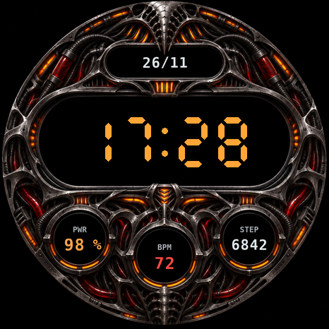
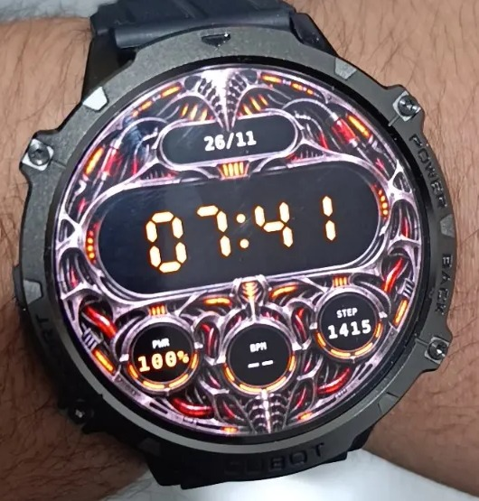

# Antimatter Hybrid MK.I — CUBOT X3

Experimental watch face by [ElTulioAlvarez](https://github.com/ElTulioAlvarez), developed as part of NeoFace Studio with help from publicly available reverse-engineering work, including [dawfu](https://github.com/david47k/dawfu) and [dawft](https://github.com/david47k/dawft).

| Parameter | Value |
|---|---|
| Device | CUBOT X3 / MOYOUNG-V2 |
| Software revision | MOY-9G32-2.0.6 |
| Template | 88 |
| Format | FaceN v35, ARGB8565 RleNew |
| Resolution | 466 x 466 |
| File | `antimatter_hybrid_mk1.bin` |
| Size | 514,460 bytes |
| CRC16 | 0x8D86 |
| SHA-256 | `8adcbc099cff33d48d46734ae2e6d70a549461a1eade9d17c925b5b4f80fe28d` |

This is byte-for-byte the custom binary installed successfully with the independent NeoFace Studio Python uploader. Time, steps and heart-rate display were observed working; battery and date rendered correctly. Heart-rate display required enabling periodic measurement in Da Fit. The binary includes custom graphics and simple geometric dash glyphs, regenerated procedurally and verified byte-for-byte. No official watch-face BIN or proprietary SDK is included.

**Compatibility warning:** tested only on the CUBOT X3 with the software revision above. The original dawfu transfer mechanism has not been tested with this file or model. Do not assume that it supports the X3's block transfer and watch-face registration sequence. This is a reference artifact, not an installation instruction. No claim of universal compatibility is made.

The sample is shared for inspection and demonstration; the upstream MIT software license is unchanged. Ask the author before redistributing or relicensing the artwork.
